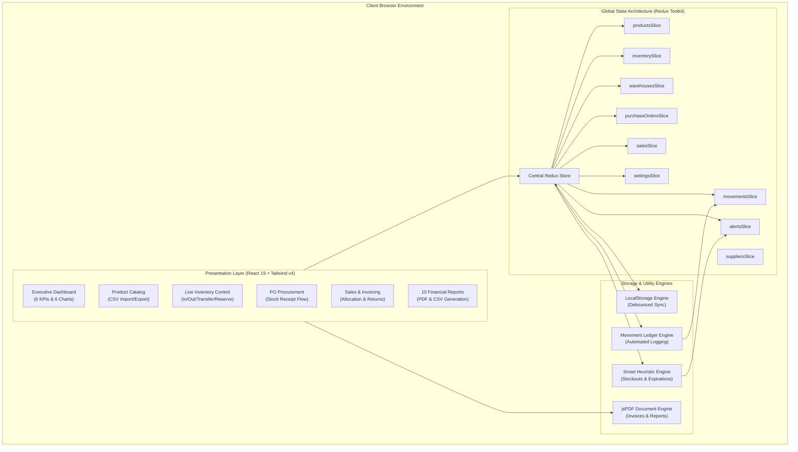

<div align="center">

# 📦 StockWise • Enterprise Inventory & Stock Intelligence

### *Next-Generation Client-Side SaaS Platform for Real-Time Supply Chain, Multi-Warehouse Operations, and Financial Analytics*

[](https://opensource.org/licenses/MIT)
[](https://react.dev/)
[](https://vitejs.dev/)
[](https://redux-toolkit.js.org/)
[](https://tailwindcss.com/)
[](https://recharts.org/)
[](CONTRIBUTING.md)

[Features](#-key-functional-modules) • [Live Demo & Setup](#-quick-start) • [Architecture](#-system-architecture) • [Data Strategy](#-deterministic-demo-data) • [Contributing](CONTRIBUTING.md) • [License](#-license)

</div>

---

## 📖 Overview

**StockWise** is an enterprise-grade, client-side SaaS web application designed for retailers, wholesalers, distributors, warehouse operators, and SMBs. It models complex, real-world inventory workflows with data relationships, live operational analytics, automated auditing, and persistent frontend storage.

> **Zero Backend Required:** The platform runs 100% inside modern web browsers with zero backend server dependencies (no Express, Node.js, MongoDB, Firebase, or Supabase required). All changes seamlessly persist in browser `LocalStorage` with debounced, safe schema serialization.

---

## 🏗️ System Architecture



---

## 🌟 Key Functional Modules

### 1. Executive Analytics Dashboard (`/`)
- **6 Dynamic KPI Metric Cards**: Live calculations for Total SKUs, Inventory Capital Valuation, Total Stored Units, Low Stock Warnings, Stockout Outages, and Pending Purchase Orders with month-over-month trend indicators.
- **6 Interactive Recharts Visualizations**:
  - *Inventory Value Over Time* (Multi-horizon 7D / 30D / 90D trend analysis)
  - *Valuation by Merchandise Category* (Donut distribution)
  - *Top Selling Products* (Horizontal velocity comparison)
  - *Stock Flow Analysis* (Inbound shipments vs outbound fulfillments)
  - *Warehouse Stock Levels* (Multi-facility volume benchmarking)
  - *Stock Health Ratios* (Healthy vs Low Stock vs Depleted SKUs)
- **Real-Time Operational Widgets**: Live movement ledger stream, instant low-stock procurement quick-actions, and recent purchase orders.

### 2. Product Catalog Management (`/products`)
- **Enterprise Product Data Table**: Search by SKU, title, brand, or barcode; multi-column sorting; paginated records; customizable visible column picker.
- **Advanced Multi-Dimension Filters**: Filter by Merchandise Category, Assigned Facility, Primary Supplier, or Stock Health status.
- **Creation & Modification Modals**: Form validation with duplicate SKU collision prevention, automated profit margin calculation, pricing, and safety buffer thresholds.
- **Bulk Operations**: Multi-selection, batch category reassignment, and safe bulk deletions.
- **Data Portability**: Full CSV Export and PapaParse-powered CSV Import with schema validation.

### 3. Category & Taxonomy Control (`/categories`)
- Categorization with custom color-coding, active product counting, and segment capital valuation.
- **Referential Integrity Protection**: Strict protection preventing accidental deletion of categories containing active products, with mandatory re-assignment workflows.

### 4. Dedicated Live Inventory Control (`/inventory`)
- Complete visibility into Physical On-Hand, Reserved Stock, Unreserved Available Stock, and Incoming Purchase Order quantities.
- **Atomic Stock Operations**:
  - **Stock In (+)**: Increments available inventory and writes an auditable receipt entry.
  - **Stock Out (-)**: Dispatches inventory with negative-balance prevention safeguards.
  - **Stock Adjustment**: Records audit count variances.
  - **Inter-Warehouse Transfer**: Atomically shifts stock between source and destination facilities.
  - **Reservation & Release**: Allocates stock to customer holds or sales orders without issuing dispatches.

### 5. Stock Movement Ledger & Audit History (`/movements`)
- Detailed ledger recording every transaction: `purchase_received`, `sales_issued`, `stock_adjustment`, `warehouse_transfer`, `stock_return`, `reserved`, and `released`.
- Filterable by transaction type, date horizon (7D / 30D / 90D), warehouse, and SKU.
- Direct **CSV Export** and **Audit-Ready PDF Export** using `jspdf` and `jspdf-autotable`.

### 6. Multi-Warehouse Facilities Management (`/warehouses`)
- Storage distribution hubs across Mumbai, Delhi, Bangalore, Kolkata, and Ahmedabad.
- Real-time **Capacity Utilization Bars** benchmarked against designated storage quotas.
- Stock manifest inspection drawer for facility-level inventory auditing.

### 7. Supplier & Vendor Relationships (`/suppliers`)
- Full vendor profiles with payment terms (Net 7, Net 15, Net 30, Net 60), contact persons, and supplied product catalogs.
- Procurement history and active PO tracking.
- Protection against deleting vendors with open purchase commitments.

### 8. Purchase Order Procurement Workflow (`/purchases`)
- Full lifecycle: `Draft` ➔ `Sent` ➔ `Partially Received` ➔ `Received` (or `Cancelled`).
- Multi-product dynamic line-item builder with automated subtotals, tax rates, and discounts.
- **Partial & Full Inwarding**: Receiving goods automatically increments physical inventory in the destination warehouse and records stock receipts in the ledger.
- Printable, downloadable formal **PDF Purchase Orders**.

### 9. Sales & Invoicing Module (`/sales`)
- Sales order creation with customer details, fulfillment warehouse selection, and line items.
- **Strict Stock Allocation Validation**: Prevents selling more units than physically available.
- Automated stock decrement and movement ledger entries on sale completion.
- **Sales Return Processing**: Seamlessly restores returned inventory back into facility stock.
- Downloadable **Sales Invoices** in PDF format.

### 10. Reports & Financial Intelligence (`/reports`)
- 10 Advanced Analytical Reports:
  1. *Inventory Valuation Report* ($\sum \text{Quantity} \times \text{Cost Price}$)
  2. *Stock Movement Flow*
  3. *Low Stock & Reorders*
  4. *Product Performance*
  5. *Category Distribution*
  6. *Supplier Procurement*
  7. *Warehouse Capacity*
  8. *Purchase Order Audit*
  9. *Sales & Revenue*
  10. *Profitability & COGS* ($\text{Gross Profit} = \text{Revenue} - \text{COGS}$)
- Integrated CSV and PDF document generation.

### 11. Smart Inventory Alerts Engine (`/notifications`)
- Automated rule heuristics flagging Out of Stock emergencies, Low Stock reorder points, Storage Overcapacity, Perishables Expiring within warning thresholds, and Overdue Vendor Deliveries.
- Severity classification (`critical`, `warning`, `info`) with quick-action navigation.

### 12. Settings & System Preferences (`/settings`)
- Organization branding and GSTIN profile.
- Multi-currency localization support (INR `₹`, USD `$`, EUR `€`, GBP `£`, AED `د.إ`).
- Configurable warning thresholds and notification subscription toggles.
- **Full JSON Backup & Restore** and **Reset Demo Data** capability.

---

## ⚡ Quick Start

### Prerequisites
- [Node.js](https://nodejs.org/) v18.0.0 or higher
- [npm](https://www.npmjs.com/) v9.0.0 or higher (or pnpm / yarn)

### 1. Clone the repository
```bash
git clone https://github.com/your-username/stockwise-inventory-intelligence.git
cd stockwise-inventory-intelligence
```

### 2. Install dependencies
```bash
npm install
```

### 3. Start development server
```bash
npm run dev
```
Open **`http://localhost:5173/`** in your browser to start exploring StockWise.

### 4. Build for production
```bash
npm run build
```
The optimized bundle will be compiled into `dist/`.

---

## 📊 Deterministic Demo Data

StockWise is seeded with a fully interconnected business ecosystem on first launch:
- **100+ Products**: Realistic prices, costs, barcodes, units, safety thresholds, and SKU numbers.
- **12 Categories**: Electronics, Clothing, Groceries, Tools, Sports, Furniture, Health, etc.
- **15 Suppliers**: Complete with payment terms, cities, contact persons, and catalog affiliations.
- **5 Operating Warehouses**: Distributed regional logistics nodes with capacity modeling.
- **100+ Historical Ledger Movements**: Real timestamped movements demonstrating balanced ledger flows.
- **50 Purchase Orders**: Diverse PO states (`draft`, `sent`, `partially_received`, `received`).
- **100 Sales Transactions**: Real completed invoices and customer returns.

*Need to reset back to baseline? Navigate to **Settings** ➔ **Reset Demo Data to Defaults**.*

---

## 📁 Repository Layout

```
stockwise-inventory-intelligence/
├── .github/
│   ├── workflows/
│   │   ├── ci.yml                 # Continuous Integration (build & lint)
│   │   └── deploy.yml             # Automated GitHub Pages deployment
│   ├── ISSUE_TEMPLATE/
│   │   ├── bug_report.yml         # Bug report template
│   │   ├── feature_request.yml    # Feature proposal template
│   │   └── config.yml             # Contact links & triage config
│   └── pull_request_template.md   # Standardized PR checklist
├── public/
│   ├── favicon.svg                # Application branding icon
│   └── icons.svg
├── src/
│   ├── components/
│   │   ├── common/                # Reusable UI primitives (Modals, Tables, Cards, Badges)
│   │   └── layout/                # Responsive Topbar, Sidebar, and AppLayout
│   ├── data/                      # Deterministic seed generator functions
│   ├── pages/                     # 12 functional SaaS pages
│   ├── store/                     # Redux Toolkit slices & debounced persistence engine
│   ├── utils/                     # Formatters, calculations & jsPDF generators
│   ├── App.jsx                    # Routing configuration
│   ├── index.css                  # Tailwind CSS v4 design tokens
│   └── main.jsx                   # Application bootstrap
├── .env.example                   # Environment configuration template
├── .gitignore                     # Git exclusion rules
├── CODE_OF_CONDUCT.md             # Contributor Covenant v2.1
├── CONTRIBUTING.md                # Contribution & PR guidelines
├── LICENSE                        # MIT License
├── package.json                   # Project metadata & dependencies
├── README.md                      # Documentation
└── vite.config.js                 # Vite build configuration
```

---

## 🤝 Contributing

We welcome community contributions, issues, and feature proposals!
Please review our [Contributing Guidelines](CONTRIBUTING.md) and [Code of Conduct](CODE_OF_CONDUCT.md) before opening a pull request.

1. Fork the repo and create your feature branch: `git checkout -b feature/amazing-feature`
2. Commit your changes: `git commit -m 'feat: add amazing feature'`
3. Push to the branch: `git push origin feature/amazing-feature`
4. Open a Pull Request

---

## 📄 License

Distributed under the **MIT License**. See [`LICENSE`](LICENSE) for more information.

<div align="center">
  <sub>Built with ❤️ by Abir • Powered by React 19, Redux Toolkit, Tailwind CSS & Recharts</sub>
</div>
